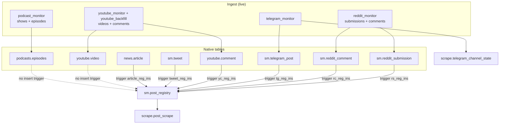
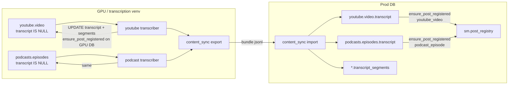
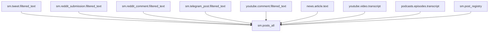
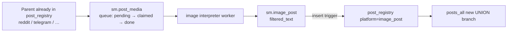
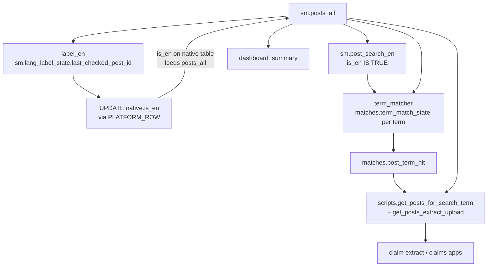

# Data flow

Source of truth for how content becomes a **post**, how derived text is attached, and who reads `sm.posts_all`. This is **not** an ER diagram: triggers, views, and workers are first-class.

**Maintenance:** if you add/change a platform, trigger, `posts_all` branch, ingest service, or worker that writes post text / `post_registry`, update this file in the same change (diagrams **and** the edge list). See `.cursor/rules/data-flow.mdc`.

Proposed (not applied): `db/potential_migrations/025_image_post.sql`. Drawn with dotted lines.

---

## Mental model

```
native row  --register-->  sm.post_registry.id  --view-->  sm.posts_all.text
```

- **Native tables** hold platform-specific columns (`sm.reddit_submission`, `youtube.video`, …).
- **`sm.post_registry`** is the global post identity `(platform, key1, key2)` → `id`. `key2` is `''` when unused (not NULL).
- **`sm.posts_all`** unions native tables into `(post_id, platform, text, tsv_en, is_en, url, …)`. Downstream jobs should read this view, not native tables, for text.
- **`sm.post_search_en`** is `posts_all` restricted to `is_en IS TRUE` (FTS candidates).

Two registration styles:

| Style | Platforms | When they become posts |
|---|---|---|
| Insert trigger | tweet, reddit_submission, reddit_comment, telegram_post, youtube_comment, news_article | On `INSERT` into the native table |
| Worker / import | youtube_video, podcast_episode | After `transcript` is written, via `ensure_post_registered()` |

YouTube **videos** and podcast **episodes** therefore exist as native rows *before* they are posts. YouTube **comments** can be posts while the parent video is still unregistered.

---

## 1. Ingest → native row → registry

Live scrapers write native rows through `ingestion/` (`InsertableRow`, `ON CONFLICT DO NOTHING`). Insert triggers (where they exist) add `post_registry`. Newly inserted keys are linked to `scrape.job` via `scrape.post_scrape`.



**Caveats (ingest):**

- Telegram `scrape_channel_batches` **drops messages with empty text**, so image-only posts never land.
- Telegram monitor resume is **not** `max(created_at_ts)`. Per-channel watermarks live in `scrape.telegram_channel_state`: catch-up only advances `high_watermark_id` after a contiguous newest-first walk; incomplete backfill continues below `low_watermark_id` until `backfill_complete`.
- Reddit `filtered_text` is title (+ selftext if `is_self`). Image URL is `shared_url` / `domain`, not `text`. Galleries / `media_metadata` are not stored.
- Reddit comments FK to submissions (`link_id`). YouTube comments FK to videos.
- Tweets and news articles have tables + insert triggers but **no live ingest service** in `services/`.
- `ingestion.platform_registry.PLATFORM_ROW` omits `tweet` and `news_article` (matters for `label_en` below).

---

## 2. Derived text → register later

YouTube/podcast rows are transcribed on a GPU (transcription venv), then registered. Prod usually receives transcripts via **content_sync** (GPU export → nitwitch bundle → prod import), which upserts native rows, writes transcript, and registers.

A older podcast-only JSONL export/import (`services/podcast/transcript_export` + `transcript_import`) still exists and also calls `ensure_post_registered`.



`posts_all` text for these platforms **is the transcript**, not title/description. Empty transcript ⇒ not in the view as a useful post (and usually not in the registry).



**Proposed image path** (`025_image_post.sql`, not applied):



Unlike transcripts, interpretation is a **child post** (new `post_id`). Parent caption is unchanged, so term matcher / claims see new ids without rematch.

---

## 3. Consumers of `posts_all`

Cursors are **monotonic on `post_registry.id`**. Updating text on an existing row does **not** re-run these jobs. New derived posts (transcripts registered late, future `image_post`) work because they get **new ids**.



**Caveats (consumers):**

- `label_en` writes `is_en` only for platforms in `PLATFORM_ROW`. **tweet** and **news_article** are skipped even if they appear in `posts_all`. `scripts/recheck_is_en.py` has a wider `PLATFORM_UPDATE_SPEC`.
- Term matcher FTS uses `post_search_en` (`is_en IS TRUE`), then span-extracts on `posts_all.text`. Posts with `is_en` NULL/false are not matched.
- Claim fetch joins `post_term_hit` → `posts_all` (term hits are the gate, not raw FTS).
- `dashboard_summary` also unions native `date_entered` for counts; keep it in sync if you add a platform.

---

## Edge list (schema cannot infer these)

Update this table when behavior changes. `kind`: `trigger` | `worker` | `view` | `service`.

| from | to | via | kind | notes |
|---|---|---|---|---|
| `sm.tweet` INSERT | `post_registry` | `tweet_reg_ins` | trigger | historical; no live scraper |
| `sm.reddit_submission` INSERT | `post_registry` | `rs_reg_ins` | trigger | |
| `sm.reddit_comment` INSERT | `post_registry` | `rc_reg_ins` | trigger | requires parent submission |
| `sm.telegram_post` INSERT | `post_registry` | `tg_reg_ins` | trigger | empty-text messages never inserted |
| `youtube.comment` INSERT | `post_registry` | `yc_reg_ins` | trigger | parent `youtube.video` must exist (FK), may not be registered yet |
| `news.article` INSERT | `post_registry` | `article_reg_ins` | trigger | no live ingest |
| `youtube.video` INSERT | *(none)* | insert trigger dropped in `005_articles` | — | metadata-only until transcript |
| `podcasts.episodes` INSERT | *(none)* | insert trigger dropped in `005_articles` | — | same |
| native DELETE | `post_registry` | `*_reg_del` | trigger | podcasts/youtube video delete still unregisters |
| reddit/telegram/youtube ingest | `scrape.post_scrape` | `flush_and_link_*` | service | podcasts not job-linked |
| telegram_monitor | `scrape.telegram_channel_state` | channel watermarks | service | resume after flood; not a post |
| `youtube.video` | `transcript` + segments | `services/youtube/transcriber` | worker | then `ensure_post_registered` |
| `podcasts.episodes` | `transcript` + segments | `services/podcast/transcriber` | worker | then `ensure_post_registered` |
| GPU DB | prod native + registry | `content_sync` export/import | worker | platforms: youtube_video, youtube_comment, podcast_episode |
| GPU podcast transcripts | prod episodes + registry | `transcript_export` / `transcript_import` | worker | older podcast-only path; still scheduled |
| `post_registry` + native | `sm.posts_all` | view UNION | view | text = filtered_text or transcript or article.text |
| `posts_all` | `post_search_en` | view | view | `WHERE is_en IS TRUE` |
| `posts_all` | native `is_en` | `services/label_en` | worker | skips platforms missing from `PLATFORM_ROW` |
| `posts_all` + `post_search_en` | `matches.post_term_hit` | `services/term_matcher` | worker | incremental `last_checked_post_id`; no rematch on text UPDATE |
| `post_term_hit` + `posts_all` | claim JSON | `scripts/get_posts_*` | service | on-demand, not a systemd timer |
| `posts_all` | summary files | `services/dashboard_summary` | worker | |
| parent post + image URL | `sm.post_media` | scrape / backfill | service | **proposed** `025` |
| `sm.post_media` | `sm.image_post` + registry | image interpreter | worker | **proposed** `025`; child post_id |

---

## Platform cheat sheet

| `post_registry.platform` | Native table | `posts_all.text` | Register | Live ingest |
|---|---|---|---|---|
| `tweet` | `sm.tweet` | `filtered_text` | insert trigger | no |
| `reddit_submission` | `sm.reddit_submission` | `filtered_text` | insert trigger | reddit_monitor |
| `reddit_comment` | `sm.reddit_comment` | `filtered_text` | insert trigger | reddit_monitor |
| `telegram_post` | `sm.telegram_post` | `filtered_text` | insert trigger | telegram_monitor |
| `youtube_video` | `youtube.video` | `transcript` | `ensure_post_registered` | monitor/backfill row; transcriber/sync registers |
| `youtube_comment` | `youtube.comment` | `filtered_text` | insert trigger | youtube_monitor |
| `podcast_episode` | `podcasts.episodes` | `transcript` | `ensure_post_registered` | podcast_monitor row; transcriber/sync registers |
| `news_article` | `news.article` | `text` | insert trigger | no |
| `image_post` | `sm.image_post` | `filtered_text` | insert trigger | **proposed** |

---

## Review checklist (humans)

After editing this file, or after a schema/worker change, check:

1. **Registration exceptions** — youtube_video / podcast_episode still have no insert trigger? Any new platform copied the wrong pattern?
2. **`posts_all` text column** — does the view still match the cheat sheet (transcript vs filtered_text)?
3. **`label_en` / `PLATFORM_ROW`** — new platform will be invisible to language labeling until both the view **and** the row class exist.
4. **Term matcher rematch** — if you *update* existing `text` instead of inserting a new registry row, hits will not refresh unless you reset `term_match_state`.
5. **Mermaid vs edge list** — if they disagree, the edge list wins; fix the diagram.
6. **Proposed vs applied** — dotted image path must not be described as live until `025` is applied.
